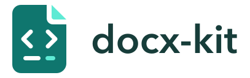

<p align="center">
  <picture>
    <source media="(prefers-color-scheme: dark)" srcset="./docs/public/brand/logo-dark.svg">
    
  </picture>
</p>

<p align="center">
  <a href="https://github.com/ntnyq/docx-kit/actions"></a>
  <a href="https://www.npmjs.com/package/docx-kit"></a>
  <a href="https://www.npmjs.com/package/docx-kit"></a>
  <a href="https://github.com/ntnyq/docx-kit/blob/main/LICENSE"></a>
</p>

<p align="center">
  <a href="./README.md">English</a> | 简体中文
</p>

**CSS 风格的 DOCX API 工具包** — 类型安全、支持插件扩展的 Word 文档生成库，适用于 Node.js 和浏览器。

---

## 📖 文档

👉 **完整指南、API 参考、插件与示例：https://docx-kit.ntnyq.dev/zh-CN/**

---

## 特性

- **CSS 风格的样式** — `fontSize`、`color`、`margin`、`border`……像写 CSS 一样定义文档样式
- **链式构建 API** — `.h1()`、`.p()`、`.table()`、`.image()`、`.use().plugin()`
- **22 个内置插件** — 条形码、二维码、ECharts、代码块、发票、目录等
- **样式预设** — `classic`（公文）、`modern`（商务）、`academic`（论文）
- **主题** — `minimal`、`ocean`、`warm`，支持设计令牌（`$colors.primary`）
- **JSON DSL** — 使用 `renderDocx()`，支持由 AI / 大语言模型驱动的文档生成
- **Markdown** — 通过 `docx-kit/markdown` 将 Markdown 转换为现有 DSL，复用样式与插件
- **AI 模板与 MCP 服务** — `report`、`invoice`、`resume`、`letter` 模板及 MCP 工具
- **跨平台** — 支持 Node.js（`save()`）和浏览器（`toBlob()`）
- **浏览器预览** — 使用 `@docxkit/renderer` 在浏览器中渲染 `.docx` 文件

## 安装

```shell
npm install docx-kit
```

```shell
yarn add docx-kit
```

```shell
pnpm add docx-kit
```

---

## 快速开始

```ts
import { createDocx, defineStyles } from 'docx-kit/node'

const doc = createDocx({
  styles: defineStyles({
    title: { fontSize: 24, fontWeight: 'bold', textAlign: 'center' },
    body: { fontSize: 12, lineHeight: 1.5 },
  }),
})

doc
  .h1('你好，docx-kit！', { className: 'title' })
  .p('这是一个段落。', { className: 'body' })
  .table({
    columns: [
      { key: 'name', title: '名称' },
      { key: 'value', title: '数值' },
    ],
    data: [{ name: '营收', value: '120 万元' }],
  })

await doc.save('output.docx') // Node.js 入口
// 浏览器：从 'docx-kit' 导入，并使用 await doc.toBlob()
```

## 插件

22 个内置插件：

- [徽章](https://docx-kit.ntnyq.dev/zh-CN/plugins/badge)
- [条形码](https://docx-kit.ntnyq.dev/zh-CN/plugins/barcode)
- [提示块](https://docx-kit.ntnyq.dev/zh-CN/plugins/callout)
- [更新日志](https://docx-kit.ntnyq.dev/zh-CN/plugins/changelog)
- [任务清单](https://docx-kit.ntnyq.dev/zh-CN/plugins/checklist)
- [代码块](https://docx-kit.ntnyq.dev/zh-CN/plugins/code-block)
- [封面](https://docx-kit.ntnyq.dev/zh-CN/plugins/cover-page)
- [数据表格](https://docx-kit.ntnyq.dev/zh-CN/plugins/data-table)
- [分隔线](https://docx-kit.ntnyq.dev/zh-CN/plugins/divider)
- [ECharts](https://docx-kit.ntnyq.dev/zh-CN/plugins/echarts)
- [插图](https://docx-kit.ntnyq.dev/zh-CN/plugins/figure)
- [发票](https://docx-kit.ntnyq.dev/zh-CN/plugins/invoice)
- [信头](https://docx-kit.ntnyq.dev/zh-CN/plugins/letterhead)
- [会议纪要](https://docx-kit.ntnyq.dev/zh-CN/plugins/meeting-minutes)
- [指标卡](https://docx-kit.ntnyq.dev/zh-CN/plugins/metric-card)
- [页码](https://docx-kit.ntnyq.dev/zh-CN/plugins/page-number)
- [属性表](https://docx-kit.ntnyq.dev/zh-CN/plugins/property-table)
- [二维码](https://docx-kit.ntnyq.dev/zh-CN/plugins/qrcode)
- [签名区](https://docx-kit.ntnyq.dev/zh-CN/plugins/signature-block)
- [时间线](https://docx-kit.ntnyq.dev/zh-CN/plugins/timeline)
- [目录](https://docx-kit.ntnyq.dev/zh-CN/plugins/toc)
- [水印](https://docx-kit.ntnyq.dev/zh-CN/plugins/watermark)

→ [插件文档](https://docx-kit.ntnyq.dev/zh-CN/plugins/)

## 贡献与安全

工具链、测试矩阵、视觉回归与性能工作流请参阅 [CONTRIBUTING.md](./CONTRIBUTING.md)。如发现疑似安全漏洞，请按照 [SECURITY.md](./SECURITY.md) 中的说明私下报告。

## 致谢

本项目基于 [docx](https://github.com/dolanmiu/docx) 开发。

## 许可证

[MIT](./LICENSE) © 2025-PRESENT [ntnyq](https://github.com/ntnyq)
