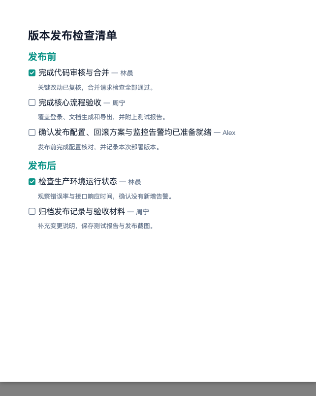

# @docxkit/plugin-checklist

Renders acceptance criteria, inspection records, and release tasks with GitHub-style graphic checkboxes by default. Items remain in input order.

## Usage

A complete Ocean theme checklist with 12pt task text, two groups, owners, notes, and both checkbox states. The sample content matches the documentation and playground.



```ts
import { createDocx } from '@docxkit/core'
import { checklistPlugin } from '@docxkit/plugin-checklist'
import { oceanTheme } from '@docxkit/theme-ocean'

const doc = createDocx({
  theme: oceanTheme,
  page: { size: { width: '170mm', height: '205mm' }, margin: '15mm' },
})
  .use(checklistPlugin())
  .add({
    type: 'plugin',
    name: 'checklist',
    style: { fontSize: 12 },
    options: {
      title: '版本发布检查清单',
      items: [
        {
          group: '发布前',
          text: '完成代码审核与合并',
          checked: true,
          owner: '林晨',
          note: '关键改动已复核，合并请求检查全部通过。',
        },
        {
          group: '发布前',
          text: '完成核心流程验收',
          owner: '周宁',
          note: '覆盖登录、文档生成和导出，并附上测试报告。',
        },
        {
          group: '发布前',
          text: '确认发布配置、回滚方案与监控告警均已准备就绪',
          owner: 'Alex',
          note: '发布前完成配置核对，并记录本次部署版本。',
        },
        {
          group: '发布后',
          text: '检查生产环境运行状态',
          checked: true,
          owner: '林晨',
          note: '观察错误率与接口响应时间，确认没有新增告警。',
        },
        {
          group: '发布后',
          text: '归档发布记录与验收材料',
          owner: '周宁',
          note: '补充变更说明，保存测试报告与发布截图。',
        },
      ],
    },
  })

await doc.toBlob()
```

## Options

| Option  | Type              | Default  | Description                                        |
| ------- | ----------------- | -------- | -------------------------------------------------- |
| `items` | `ChecklistItem[]` | Required | Ordered tasks; an empty array renders `(no items)` |
| `checkboxStyle` | `'github' \| 'native'` | `'github'` | Static rounded graphics, or native Word controls that can be toggled |
| `title` | `string`          | —        | Optional checklist heading                         |

### `ChecklistItem`

| Field     | Type      | Default  | Description                              |
| --------- | --------- | -------- | ---------------------------------------- |
| `text`    | `string`  | Required | Task label and checkbox alias            |
| `checked` | `boolean` | `false`  | Initial checked state                    |
| `group`   | `string`  | —        | Heading emitted when the group changes   |
| `owner`   | `string`  | —        | Responsible person, after the task label |
| `note`    | `string`  | —        | Indented note below the task             |

Adjacent items with the same group share one heading. A group that reappears later gets a new heading; items are never sorted or regrouped. Ungrouped items reset the current group.

The default style embeds SVG graphics with high-resolution PNG fallbacks. Checked boxes use the theme's `accent` color (falling back to `primary`); unchecked outlines use `muted` (falling back to `border`) with a `background` fill. Graphic checkboxes scale with the task's effective font size and align with the text's visual center. Set `checkboxStyle: 'native'` when the checkboxes need to be toggled in Word.

Notes scale to approximately 80% of the task's effective font size to keep a clear text hierarchy.

Owner labels scale to approximately 85% of the task font size and always retain the theme's `muted` color, including when the task text color is overridden.

Group headings are bold, use the theme's `accent` color (falling back to `primary`), and scale to approximately 120% of the task font size. The optional checklist title uses `primary` at approximately 140%. Explicit invocation colors override these defaults.

See the [full reference](../../docs/plugins/checklist.md) for platform notes and styling.
